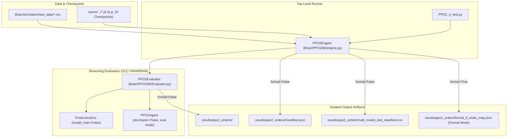

# Specification: PPO2 Dedicated Testing & Order Export Environment

- **Category**: `feature`
- **Spec Path**: `spec/feature/ppo2_dedicated_test_environment.md`
- **Status**: `Implemented & Verified`

## 📋 Index / Contents
1. [1. Background & Requirements Analysis](#1-background--requirements-analysis)
2. [2. Target Scope & Architecture Boundaries](#2-target-scope--architecture-boundaries)
3. [3. Implementation Checklist & Detailed Blueprint](#3-implementation-checklist--detailed-blueprint)
4. [4. Validation & Verification Plan](#4-validation--verification-plan)

---

## 1. Background & Requirements Analysis

### 1.1 Context & Motivation
In [`DQN_rl_test.py`](file:///home/b0457812963/Mamba3RL/SynapseX/DQN_rl_test.py), batch evaluation is coupled with an internal backtesting engine ([`Brain/DQN/lib/Backtest.py`](file:///home/b0457812963/Mamba3RL/SynapseX/Brain/DQN/lib/Backtest.py)). The existing pipeline calculates profit/loss, slippage/fee friction, equity curves, drawdowns, and renders charts via Matplotlib and QuantStats. 

For the newly developed continuous actor-critic pipeline ([`PPO2_rl_train.py`](file:///home/b0457812963/Mamba3RL/SynapseX/PPO2_rl_train.py)), we require a dedicated, lightweight testing environment that completely decouples RL strategy inference from financial performance accounting. All subsequent backtesting and performance analytics will be handled by external, specialized quantitative backtesting frameworks (such as VectorBT, Backtrader, or custom accounting systems).

### 1.2 User Specific Requirements
1. **Output Format (Option B)**:
   - Export structured tabular order files per symbol and per model, containing: `Datetime`, `Symbol`, `Close`, `Action` (continuous target position $\in [-1.0, 1.0]$), and resulting `Position`.
   - Avoids secondary timestamp alignment in downstream backtesting engines.
2. **Full Instrument Batch Testing**:
   - Automatically evaluate across all available test symbols located in [`Brain/simulation/test_data/`](file:///home/b0457812963/Mamba3RL/SynapseX/Brain/simulation/test_data).
3. **Multi-Checkpoint Comparison**:
   - Allow user configuration to test specific checkpoints (e.g., comparing 10 different checkpoints simultaneously, such as `checkpoint_iter_10.pt` to `checkpoint_iter_100.pt`), or auto-discover checkpoints from a directory.
4. **Dual Output Modes (Test vs. Formal)**:
   - **Test Mode (`formal=False`)**: Generates chronological time-series order CSV files across the entire historical test dataset.
   - **Formal Live Mode (`formal=True`)**: Generates the latest step's target order dictionary (`if_order_map: {symbol: target_action}`) for live execution by [`TradingSysteam.py`](file:///home/b0457812963/Mamba3RL/SynapseX/TradingSysteam.py).
5. **No PnL & No Plotting**:
   - Zero dependency on Matplotlib or QuantStats. Zero computation of equity metrics or tear sheets.

---

## 2. Target Scope & Architecture Boundaries

### 2.1 File & Module Scope Matrix
| Index | Target File | Scope | Description |
| :---: | :--- | :---: | :--- |
| **Item 1** | `Brain/PPO2/lib/Evaluator.py` | **In-Scope (New)** | Implements `PPO2Evaluator`, handling model weight loading, deterministic inference (`stochastic=False`), chronological stepping, and tabular CSV exporting. |
| **Item 2** | `Brain/PPO2/lib/engine.py` | **In-Scope (New)** | Implements `PPO2Engine`, coordinating multi-model and multi-symbol streaming evaluation, memory deallocation, manifest aggregation, and `get_if_order_map` for live execution. |
| **Item 3** | `PPO2_rl_test.py` | **In-Scope (New)** | Top-level execution entrypoint matching [`DQN_rl_test.py`](file:///home/b0457812963/Mamba3RL/SynapseX/DQN_rl_test.py), offering options for batch checkpoint testing, custom model lists, and formal mode. |
| **Item 4** | `tests/test_ppo2_evaluator.py` | **In-Scope (New)** | Unit tests validating deterministic action outputs, tabular CSV format, edge-case termination, and memory safety. |
| **Item 5** | [`Brain/PPO2/lib/environment.py`](file:///home/b0457812963/Mamba3RL/SynapseX/Brain/PPO2/lib/environment.py) | **Out-of-Scope (Preserved)** | Reuses existing `ProductionEnv` with `model_train=False`. |
| **Item 6** | [`Brain/PPO2/lib/Agent.py`](file:///home/b0457812963/Mamba3RL/SynapseX/Brain/PPO2/lib/Agent.py) | **Out-of-Scope (Preserved)** | Reuses `PPO2Agent.get_action(obs, stochastic=False)`. |
| **Item 7** | [`DQN_rl_test.py`](file:///home/b0457812963/Mamba3RL/SynapseX/DQN_rl_test.py), [`Brain/DQN/lib/Backtest.py`](file:///home/b0457812963/Mamba3RL/SynapseX/Brain/DQN/lib/Backtest.py) | **Out-of-Scope (Preserved)** | Untouched legacy DQN testing logic. |

### 2.2 System Architecture Diagram



---

## 3. Implementation Checklist & Detailed Blueprint

### 3.1 Step-by-Step Task Checklist
- [x] **Step 1: Create `Brain/PPO2/lib/Evaluator.py`**
  - [x] Implement `PPO2Evaluator`:
    - [x] `__init__(agent: PPO2Agent, bars_count: int, device: torch.device)`
    - [x] `evaluate_symbol(symbol: str, raw_df: pd.DataFrame, prices: Prices, output_csv_path: Optional[str]) -> pd.DataFrame`
    - [x] Deterministic stepping loop: from `offset = bars_count` to `len(prices.close) - 1`.
    - [x] Extraction of step records: `Datetime` (from `raw_df`), `Close` price, `Action` (`out.clipped_action.item()`), `Position` (`env._state.position`).
    - [x] Option B CSV export: columns `[Datetime, Symbol, Close, Action, Position]`.
    - [x] `evaluate_single_step(obs) -> float`: Evaluates single latest observation for formal mode.
- [x] **Step 2: Create `Brain/PPO2/lib/engine.py`**
  - [x] Implement `PPO2Engine`:
    - [x] Parameter `formal: bool` (default `False`).
    - [x] `prepare(target_symbols: List[str], model_paths: Optional[List[str]] = None, model_dir: Optional[str] = None)`
    - [x] Multi-model discovery & resolution (parsing checkpoint names, sorting).
    - [x] Model architecture builder: dynamically instantiates `PPO2Agent` using configuration from Hydra `configs/training/ppo_v2.yaml`.
    - [x] `run_test(output_dir: str = "results/ppo2_orders") -> pd.DataFrame`:
      - [x] Outer loop over each model.
      - [x] Inner loop over each symbol with streaming data loading.
      - [x] Explicit garbage collection and CUDA cache clearing after each symbol and model.
      - [x] Generates per-model `manifest.json` and consolidated `multi_model_test_manifest.csv`.
    - [x] `get_if_order_map(data_source: Union[pd.DataFrame, Dict[str, pd.DataFrame]]) -> Dict[str, float]`:
      - [x] Extracts the latest K-bar window for each symbol.
      - [x] Computes deterministic action and returns `{symbol: target_action}`.
      - [x] Exports `results/ppo2_orders/formal_if_order_map.json`.
- [x] **Step 3: Create top-level `PPO2_rl_test.py`**
  - [x] Support user options:
    - [x] **Option 1 (Default)**: Batch test all checkpoints in a designated directory.
    - [x] **Option 2 (Custom Model List)**: User-specified list of `.pt` files (e.g., 10 checkpoints).
    - [x] **Option 3 (Formal Mode)**: Generate live order map for immediate execution.
  - [x] Progress reporting and clean logging.
- [x] **Step 4: Create automated unit tests in `tests/test_ppo2_evaluator.py`**
  - [x] Test deterministic output reproducibility.
  - [x] Test CSV schema (Option B: `Datetime`, `Symbol`, `Close`, `Action`, `Position`).
  - [x] Test non-termination before end of dataset and termination at boundary.
  - [x] Test formal `get_if_order_map` output integrity.

### 3.2 Tabular Data Schema (Option B)

```csv
Datetime,Symbol,Close,Action,Position
2023-01-01 00:00:00,BTCUSDT,16540.25,0.4523,0.4523
2023-01-01 00:30:00,BTCUSDT,16585.10,0.7812,0.7812
2023-01-01 01:00:00,BTCUSDT,16490.00,-0.3200,-0.3200
```

### 3.3 Manifest Data Schema

```json
{
  "model_name": "checkpoint_iter_50",
  "total_symbols_evaluated": 179,
  "symbols": {
    "BTCUSDT": {
      "total_bars": 12500,
      "mean_action": 0.124,
      "std_action": 0.451,
      "long_ratio": 0.52,
      "short_ratio": 0.38,
      "flat_ratio": 0.10,
      "order_file": "results/ppo2_orders/checkpoint_iter_50/BTCUSDT_orders.csv"
    }
  }
}
```

---

## 4. Validation & Verification Plan

### 4.1 Empirical Test Execution
All verification scripts MUST run using the project virtual environment Python binary:
```bash
/home/b0457812963/Mamba3RL/bin/python -m unittest tests/test_ppo2_evaluator.py
```

### 4.2 Acceptance Criteria
1. **Zero Financial Math / Plotting**: Codebase contains no calls to `quantstats` or `matplotlib.pyplot` during test runs.
2. **Deterministic Output**: Given identical checkpoint weights and data, multiple runs produce bit-for-bit identical action sequences.
3. **Tabular CSV Accuracy**: Each row contains valid `Datetime`, float `Close`, float `Action` $\in [-1.0, 1.0]$, and float `Position` $\in [-1.0, 1.0]$.
4. **Memory Stability**: VRAM footprint remains bounded ($< 2.0$ GB on RTX 2060) across 179 symbols and 10 models due to streaming deallocation.
5. **Formal Map Compatibility**: Formal mode outputs a JSON file mapping `{symbol: float}` directly ingestible by `TradingSysteam.py`.
